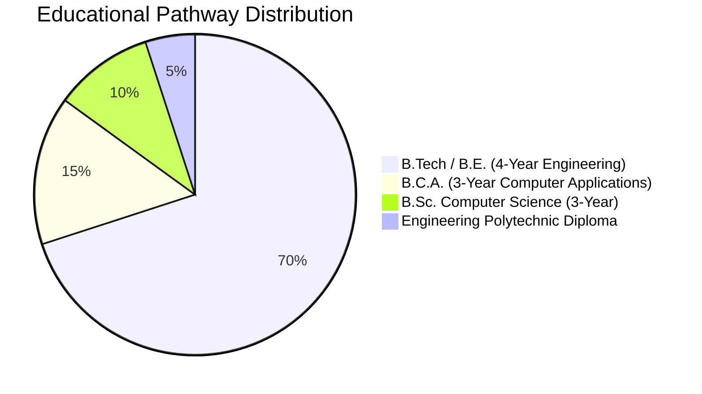
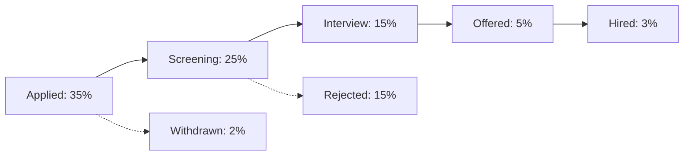

# TALENTRA — SYNTHETIC DATA DISTRIBUTIONS & SPECIFICATION

## 1. Overview & Determinism Guarantee

All synthetic data generated by the Talentra Seeding & Data Generation Engine is **100% deterministic**. Given a fixed random seed (default: `42`), the generator produces the exact same sequence of names, credentials, education pathways, scores, job requisitions, and application pairings.

Statistical distributions are explicitly configurable and modeled after real-world engineering recruitment and academic placement pipelines across South Asia (India), North America, and Europe.

---

## 2. Candidate Demographics & Identity Distribution

| Attribute | Generator Modeling | Values & Relative Frequencies |
|---|---|---|
| **Given Names** | Uniform random selection from curated multilingual list | 50% Indian names, 30% Western names, 20% Global |
| **Family Names** | Uniform random selection | Representative regional surnames |
| **Public Actor IDs** | Atomic sequence `PPNNNNN` | Exactly `CA00001` through `CA99999` for first 99,999 accounts |
| **Scale Business Profiles** | Profiles without provisioned auth accounts | Unprovisioned synthetic candidate profiles (strictly no wrapping) |
| **Email Namespace** | Deterministic synthetic address | `scale.cand.{index}@talentra.io` |
| **Phone E.164** | ITU-T standard format | `+9198765{index:05d}` with India country mapping |

---

## 3. Academic History & Qualification Distributions

### 3.1 Educational Pathways

Candidates follow realistic academic degree progressions:

- **Undergraduate Completion Duration:**
  - 4 Years for B.Tech / B.E.
  - 3 Years for B.C.A. / B.Sc. Computer Science
  - 3 Years for Polytechnic Diploma
- **Postgraduate Distribution:** ~25% of candidates possess subsequent Master's qualifications (`M.Tech`, `M.C.A.`, `M.B.A.`, or `M.S.`).

### 3.2 Academic Performance & Grading Distribution

Academic grades follow a truncated Gaussian (normal) distribution calibrated against premier technical universities:

- **Mean CGPA ($\mu$):** `7.80` on a 10.0 scale
- **Standard Deviation ($\sigma$):** `1.10`
- **Minimum Value:** `5.50`
- **Maximum Value:** `9.95`
- **Percentage Equivalent:** Calculated as $\text{CGPA} \times 10$ for standard conversions.

### 3.3 Backlog & Arrears Probability Distribution

- **Zero Backlogs (Clean Track):** `88.0%` of candidates.
- **Cleared / Historical Backlogs:** `8.5%` of candidates (had backlogs in early semesters, successfully cleared prior to graduation).
- **Active Backlogs:** `3.5%` of candidates (currently active uncleared backlogs, used to trigger eligibility rejections).

---

## 4. Technical Skills Taxonomy & Proficiency Distribution

Every candidate profile is allocated between **3 and 5 technical skills** selected from the normalized skill catalog:

| Domain | Skills | Allocation Frequency | Primary Skill Probability |
|---|---|---|---|
| **Backend & Systems** | `Python`, `PostgreSQL`, `Distributed System Design`, `FastAPI` | 45% | 60% |
| **Frontend & Mobile** | `React.js`, `TypeScript`, `Next.js` | 25% | 20% |
| **Cloud & DevOps** | `Docker`, `Kubernetes`, `AWS`, `CI/CD & DevOps`, `Redis` | 20% | 15% |
| **Data & Machine Learning**| `Machine Learning`, `PyTorch`, `SQL` | 10% | 5% |

### Proficiency Levels
- `INTERMEDIATE`: `50%`
- `ADVANCED`: `35%`
- `EXPERT`: `15%`

---

## 5. Job Requirements & Structured Eligibility Rules

### 5.1 Employment & Work Type Distributions

- **Employment Type:**
  - `FULL_TIME`: 75%
  - `CONTRACT`: 15%
  - `INTERNSHIP`: 10%
- **Work Type:**
  - `HYBRID`: 55%
  - `REMOTE`: 30%
  - `ONSITE`: 15%

### 5.2 Structured Cutoff Parameters

- **Minimum CGPA Cutoff:** Ranging from `6.00` to `7.50` (Mode: `6.50`).
- **Minimum Percentage Cutoff:** Ranging from `60.0%` to `75.0%`.
- **Backlog Strictness:**
  - `allow_backlogs = False` (Zero active backlogs permitted): `80%` of requisitions.
  - `allow_backlogs = True` (Up to 1 or 2 active backlogs allowed): `20%` of requisitions.
- **Experience Range:** Minimum 1-5 years, Maximum 4-15 years.
- **Compensation Ranges:**
  - Entry/Junior: ₹6,00,000 – ₹12,00,000 INR
  - Mid-Level: ₹14,00,000 – ₹24,00,000 INR
  - Staff / Principal: ₹30,00,000 – ₹60,00,000 INR

---

## 6. Application Volume & Status Lifecycle Funnel

In a healthy talent marketplace, application volume follows a standard recruitment funnel distribution:

| Application Status | Code | Funnel Percentage | Average Days in State |
|---|---|---|---|
| **APPLIED** | 1 | `35.0%` | 1 – 3 days |
| **SCREENING** | 2 | `25.0%` | 3 – 7 days |
| **INTERVIEW** | 3 | `15.0%` | 7 – 14 days |
| **OFFERED** | 4 | `5.0%` | 3 – 5 days |
| **HIRED** | 5 | `3.0%` | Terminal |
| **REJECTED** | 6 | `15.0%` | Terminal |
| **WITHDRAWN** | 7 | `2.0%` | Terminal |

---

## 7. Organization & Tenant Distribution

- **Enterprise Accounts:** Account to Organisation hierarchy (1 Account : 1-3 Organisations).
- **Recruiter Mappings:** 2 to 5 Recruiters mapped per hiring organization.
- **Licence Allocations:** Standard enterprise seats (10–50 seats per licence), with single-seat exhaustion fixtures for boundary testing.
- **Geographic Clusters:** Major technology hubs:
  - Bengaluru, Mumbai, Hyderabad, Pune, Delhi NCR (India)
  - San Francisco, San Jose, New York City (United States)
  - London, Manchester (United Kingdom)
