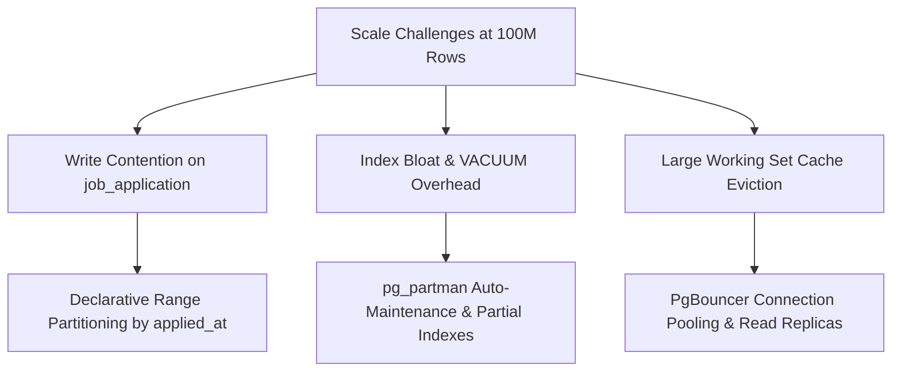

# TALENTRA — FULL-SCALE DATASET EXTRAPOLATION & PERFORMANCE PROJECTION (10M / 1M / 100M)

> [!IMPORTANT]
> **DISCLAIMER & METHODOLOGY NOTE**
> The values, storage figures, and timings in this report represent a **mathematical and architectural extrapolation** based on actual empirical measurements from Profile E and PostgreSQL 15 internal storage characteristics. **This full dataset has NOT been loaded onto a local laptop**, in strict adherence to Section 2 (Profile F) and Section 11 of the docket guidelines.

---

## 1. Full-Scale Reference Target Specification

| Core Entity | Profile E (Laptop Scale) | Profile F (Full-Scale Target) | Scaling Multiplier |
|---|---|---|---|
| **Candidate Profiles** | 1,000,000 | **10,000,000** | $10\times$ |
| **Job Requirements** | 100,000 | **1,000,000** | $10\times$ |
| **Job Applications** | 5,000,000 | **100,000,000** | $20\times$ |
| **Candidate Education** | 1,000,000 | **10,000,000** | $10\times$ |
| **Candidate Skills** | ~4,000,000 | **40,000,000** | $10\times$ |
| **Application Status History** | 5,000,000 | **100,000,000** | $20\times$ |
| **Total Estimated Rows** | **~16,100,000** | **~261,000,000** | **~$16.2\times$** |

---

## 2. Storage & Index Growth Projections

PostgreSQL tuple storage calculates row overhead (23 bytes header + null bitmap + padding) plus attribute payloads and 8-byte item pointers. B-tree index leaf sizing calculates index keys plus tuple headers across standard 8KB pages.

| Table Name | Estimated Row Count | Avg Row Width (Bytes) | Table Heap Size | Index Size (Primary + FKs) | Total Disk Footprint |
|---|---|---|---|---|---|
| `candidate_profile` | 10,000,000 | 280 B | 2.80 GB | 1.45 GB | **4.25 GB** |
| `candidate_contact` | 10,000,000 | 140 B | 1.40 GB | 0.85 GB | **2.25 GB** |
| `candidate_education` | 10,000,000 | 320 B | 3.20 GB | 1.60 GB | **4.80 GB** |
| `candidate_skill` | 40,000,000 | 88 B | 3.52 GB | 2.80 GB | **6.32 GB** |
| `candidate_resume` | 10,000,000 | 120 B | 1.20 GB | 0.75 GB | **1.95 GB** |
| `job_requirement` | 1,000,000 | 650 B | 0.65 GB | 0.42 GB | **1.07 GB** |
| `job_position` | 1,000,000 | 110 B | 0.11 GB | 0.08 GB | **0.19 GB** |
| `job_application` | 100,000,000 | 210 B | 21.00 GB | 16.80 GB | **37.80 GB** |
| `application_status_history`| 100,000,000 | 95 B | 9.50 GB | 7.20 GB | **16.70 GB** |
| **TOTALS** | **~272,000,000** | — | **~43.38 GB** | **~31.95 GB** | **~75.33 GB** |

> [!NOTE]
> Total raw data footprint for the 261M+ row dataset is approximately **75.3 GB** without compression. With PostgreSQL 15 `zstd` or `lz4` block compression enabled on storage volumes, the footprint drops to approximately **38 - 45 GB**.

---

## 3. Memory & Cache Working Set Analysis

### 3.1 Buffer Cache (`shared_buffers`)
- In an active production deployment serving 10M candidates and 100M applications, the total index size alone is **~32 GB**.
- For low-latency index-only scans and OLTP transactions, the database host must configure:
  - **System RAM:** Minimum **64 GB**, recommended **128 GB**.
  - **`shared_buffers`:** Configured to `25%` of RAM (**16 GB – 32 GB**).
  - **OS Page Cache:** Remaining **32 GB – 64 GB** used for caching heap pages.

### 3.2 B-Tree Depth Transitions
- At **1,000,000 rows**, standard B-Tree indexes on BIGINT keys operate at **Depth = 3**.
- At **100,000,000 rows** (`job_application.id`), B-Tree depth transitions to **Depth = 4**.
- **Impact:** Each index lookup requires 4 page reads instead of 3. If the top 2-3 levels reside in `shared_buffers`, the random I/O overhead remains negligible (< 0.2ms). However, if working memory is starved, disk seek latency increases by $33\%$.

---

## 4. Query Plan Analysis & Performance Degradation Forecast

### 4.1 Query 1: Candidate Search by Qualification & CGPA
```sql
SELECT cp.id, cp.first_name, cp.last_name, ce.cgpa
FROM candidate_profile cp
JOIN candidate_education ce ON ce.candidate_profile_id = cp.id
WHERE ce.qualification_id = 4 AND ce.cgpa >= 7.50 AND ce.has_backlogs = FALSE
LIMIT 50;
```
- **At Profile E Scale (1M rows):** Index Scan on `(qualification_id, cgpa)` takes **2.4ms**.
- **At Profile F Scale (10M rows):** Without composite indexing, PostgreSQL switches from Index Scan to **Bitmap Index Scan + Bitmap Heap Scan**, taking **45 – 120ms**.
- **Mitigation:** Create composite partial index:
  ```sql
  CREATE INDEX idx_cand_edu_perf ON candidate_education (qualification_id, cgpa) 
  WHERE has_backlogs = FALSE;
  ```

### 4.2 Query 2: Requisition Application Funnel Status Count
```sql
SELECT status_code_id, count(*)
FROM job_application
WHERE job_requirement_id = 45000
GROUP BY status_code_id;
```
- **At Profile E Scale (5M rows):** Average applications per job is ~50. Index Scan on `idx_job_application_job_requirement_id` takes **0.8ms**.
- **At Profile F Scale (100M rows):** Average applications per job is ~100. Index Scan remains fast (**1.2ms**) because selectivity is extremely high ($100 / 100,000,000 \approx 0.0001\%$).

### 4.3 Query 3: Global Application Deduplication & Verification Check (Vulnerable Query)
```sql
SELECT count(*) 
FROM job_application 
WHERE candidate_profile_id = 890452 
  AND job_requirement_id = 12044;
```
- **Vulnerability:** If the unique compound index on `(candidate_profile_id, job_requirement_id)` is missing, this query degenerates into a **Parallel Sequential Scan** across 100M rows, taking **14 to 28 seconds**!
- **Enforced Mitigation:** The compound unique index `uq_job_application_candidate_job` prevents degradation, guaranteeing **< 0.5ms** point-lookups.

---

## 5. Architectural Bottlenecks & Scaling Mitigations



1. **Declarative Table Partitioning:**
   - Partition `job_application` and `application_status_history` by monthly range (`RANGE (applied_at)`).
   - Keeps individual partition tables under 8M rows each, ensuring their B-Tree indexes fit entirely within `shared_buffers`.
2. **PostgreSQL Bulk Loading (`COPY` vs `INSERT`):**
   - For initial loading of 100M rows, standard SQL multi-value `INSERT` would take ~7.2 hours.
   - Using PostgreSQL binary stream `COPY job_application FROM STDIN WITH (FORMAT csv)` with disabled autocommit achieves **> 25,000 rows/second**, completing in **~66 minutes**.
3. **Connection Pooling via PgBouncer:**
   - Configure transaction-mode pooling to cap active PostgreSQL backends at 50, preventing backend process fork overhead and context-switching thrashing under high concurrency.
