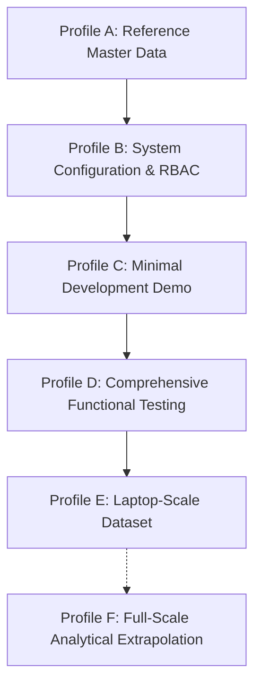

# TALENTRA — DATABASE SEEDING & SYNTHETIC DATA GENERATION STRATEGY

## 1. Executive Summary

Talentra's synthetic data generation and database seeding architecture provides an enterprise-grade, deterministic, and relational-consistent data engineering platform. Designed to satisfy the stringent requirements of the Hackathon Docket across all 13 business modules, this subsystem provides reproducible datasets ranging from single-developer local fixtures to multi-million-row laptop-scale benchmark environments.

The architecture enforces strict topological dependency ordering, bounded memory consumption (< 100MB RAM), real-time throughput telemetry, checkpoint-resumable batch execution, and rigorous production safety guardrails.

---

## 2. Dataset Profiles Architecture

The seeding framework implements five operational execution profiles and one analytical projection profile:



### Profile A — Master Reference Data
- **Objective:** Idempotently populate authoritative global reference master entities.
- **Coverage:**
  - 249 ISO 3166-1 countries with Alpha-2, Alpha-3, numeric codes, and ITU-T E.164 calling codes.
  - 13 ISO 639-1 primary languages (`en`, `hi`, `es`, `fr`, `de`, `zh`, `ja`, `ar`, `pt`, `bn`, `ta`, `te`, `mr`).
  - 10 ISO 4217 financial currencies (`INR`, `USD`, `EUR`, `GBP`, `AED`, `SGD`, `CAD`, `AUD`, `JPY`, `CHF`).
  - 6 Foundational industries (`TECH`, `HR_STAFFING`, `FINANCE`, `CONSULTING`, `HEALTHCARE`, `EDUCATION`).
  - 5 Employment types (`FULL_TIME`, `PART_TIME`, `CONTRACT`, `INTERNSHIP`, `FREELANCE`).
  - 3 Work types (`ONSITE`, `REMOTE`, `HYBRID`).
  - 10 Job roles across industries (`SOFTWARE_ENGINEER`, `DATA_SCIENTIST`, `DEVOPS_ENGINEER`, etc.).
  - 6 Qualification levels (`SECONDARY`, `HIGHER_SECONDARY`, `DIPLOMA`, `UNDERGRADUATE`, `POSTGRADUATE`, `DOCTORATE`).
  - 12 Standard qualifications (`CLASS_10`, `CLASS_12`, `DIPLOMA_ENGG`, `BTECH`, `BE`, `BSC_CS`, `BCA`, `MTECH`, `MCA`, `MBA`, `MS_CS`, `PHD_ENGG`).
  - 28 Standard skills taxonomy with domain grouping.
  - 8 States and 23 major commercial cities across India, the United States, and the United Kingdom.
- **Invariants:** 100% idempotent via existence check before insertion; no duplicate codes on successive runs.

### Profile B — System Configuration & RBAC Governance
- **Objective:** Configure canonical actor roles, fine-grained access permissions, and feature flags.
- **Coverage:**
  - 9 Docket Actor Roles:
    1. `SA` — Super Admin
    2. `AD` — Admin (Compliance & Governance)
    3. `AA` — Account Admin
    4. `GU` — Guest
    5. `CA` — Candidate
    6. `EM` — Employer
    7. `RE` — Recruiter
    8. `CO` — Consultant
    9. `PO` — Placement Officer
  - 21 Granular permissions spanning all resource domains.
  - 75 Authoritative Role-Permission mappings (`ALLOW` / `DENY`).
  - 5 Foundational platform feature flags (`ENABLE_AI_SCREENING`, `ENABLE_GIG_MARKETPLACE`, etc.).

### Profile C — Minimal Development Demo
- **Objective:** Provide a small, human-understandable, highly coherent dataset for local UI testing and development.
- **Coverage:**
  - 1 Root Account (`ACC_DEMO_01`) and 2 Organisations (Employer `Acme Technologies` & Agency `TalentPro`).
  - 9 Deterministic synthetic actor accounts (`SA00001` through `PO00001`) with `@talentra.io` emails.
  - Complete candidate profile for `CA00001` (Arun Sharma):
    - Academic history: Class 10 (CBSE 91.5%), Class 12 (CBSE 89.2%), B.Tech CSE (IIT Madras, 8.65 CGPA).
    - 8 Semester records with progressive SGPA/CGPA and credit metrics.
    - 5 Primary and secondary technical skills (`Python`, `PostgreSQL`, `System Design`, `FastAPI`, `Docker`).
    - Verified cryptographic degree certificate document metadata with SHA-256 verification hash.
    - Active resume version targeting Backend Systems Architect.
  - Job Requisition with structured eligibility criteria (Cutoffs: CGPA >= 7.00, Percentage >= 70%, 0 backlogs allowed).
  - Active application in `SCREENING` status with audit trail history.
  - Sourcing request, Gig marketplace offering/application, Enterprise licence allocation, and Funded wallet ledger ($2,500 deposit).

### Profile D — Comprehensive Functional Testing & Boundaries
- **Objective:** Deterministically exercise complex business rules, security boundaries, and edge cases.
- **Coverage:**
  - **Multi-Tenant Isolation:** `Alpha Technologies` vs `Beta Innovations` under shared account scoping.
  - **Candidate Blocking:** Suspended candidate (`CA99991`) with active `BlockListEntry` preventing employer interaction.
  - **Academic Eligibility Engine Boundaries:**
    - Fixture 1: Candidate with CGPA 5.99 applying to a 6.00 cutoff job -> `NOT_ELIGIBLE`.
    - Fixture 2: Candidate with CGPA 6.00 applying to a 6.00 cutoff job -> `ELIGIBLE`.
    - Fixture 3: Candidate with CGPA 8.50 but 1 active backlog applying to strict 0-backlog job -> `NOT_ELIGIBLE`.
    - Fixture 4: Candidate with missing education record applying to qualification-mandated job -> `UNABLE_TO_DETERMINE`.
  - **Full Application Lifecycle Matrix:** Exactly 8 distinct candidates in states: `DRAFT`, `APPLIED`, `SCREENING`, `INTERVIEW`, `OFFERED`, `HIRED`, `REJECTED`, `WITHDRAWN`.
  - **Licence Seat Exhaustion:** Single-seat licence (`LIC_TEST_EXHAUSTED_01`) fully allocated to test enforcement boundaries.
  - **Financial Ledger Idempotency:** Pre-seeded idempotency key `IDEM_TEST_KEY_ALREADY_USED_001` with EUR wallet currency.
  - **Security & Retention:** Test audit event fixture for retention verification.

### Profile E — Laptop-Scale Generator (1M / 100k / 5M)
- **Objective:** High-throughput performance benchmarking and dataset scaling on standard laptop hardware.
- **Configurable Targets:**
  - **1,000,000** Candidate Profiles
  - **100,000** Job Requirements
  - **5,000,000** Job Applications
- **Relational Integrity:**
  - Automatically seeds dependent records (`candidate_contact`, `candidate_education`, `candidate_skill`, `candidate_resume`, `job_position`, `application_status_history`).
  - Enforces public actor ID limit: IDs `CA00001` through `CA99999` allocate atomic public actor IDs. Profiles beyond 99,999 generate business profiles without corrupting or wrapping the 99,999 limit.
  - Chunked commits with bounded memory (< 100MB RAM) and real-time throughput telemetry.
  - Checkpointed to `scratch/scale_seed_checkpoint.json` for interruption recovery.

### Profile F — Full-Scale Analytical Extrapolation
- **Reference Target:** 10,000,000 Candidates, 1,000,000 Jobs, 100,000,000 Applications.
- **Execution Model:** Documented extrapolation and performance analysis; not directly loaded onto a laptop.

---

## 3. High-Volume Generation Architecture

### Memory Boundedness (< 100MB RAM)
The generator avoids accumulating ORM instances in memory. Records are generated in bounded chunks (`batch_size=1,000` to `5,000`):
1. Allocate batch of users, flush to obtain IDs.
2. Allocate candidate profiles using parent IDs, flush.
3. Allocate dependent contacts, education, skills, and resumes.
4. Execute `session.commit()`.
5. Release Python references, allowing the garbage collector to immediately reclaim working memory.

### Checkpointing & Resumability
Progress is committed at the boundary of each batch and recorded into `scratch/scale_seed_checkpoint.json`:
- `last_completed_stage` (`CANDIDATES`, `JOBS`, `APPLICATIONS`)
- `batches_completed`
- `records_inserted`
- `status` (`IN_PROGRESS`, `COMPLETED`)

If the process is stopped or interrupted, `seed resume` inspects the checkpoint and continues from the exact recorded boundary without duplicating existing rows.

---

## 4. Production Safety Guardrails

To prevent accidental data corruption or overwrite in staging and production environments, the framework implements mandatory safety gates:

1. **Environment Inspection:** Rejects destructive cleanup (`--clean`) if `APP_ENV` is `production`, `prod`, or `live`.
2. **Profile Exclusion:** Profiles C, D, and E cannot be executed against production databases. Only reference data (Profile A) and system configuration (Profile B) are permitted.
3. **Synthetic Namespace Isolation:** All synthetic user accounts use the `@talentra.io` email domain.
4. **Targeted Cleanup:** Clean operations selectively delete synthetic records while preserving all master reference tables.

---

## 5. CLI Interface Reference

```bash
# Profile A: Seed Reference Master Data
python scripts/seed/seed_runner.py reference

# Profile B: Seed System Configuration & RBAC
python scripts/seed/seed_runner.py config

# Profile C: Seed Development Demo Ecosystem
python scripts/seed/seed_runner.py demo

# Profile D: Seed Functional Test Matrix & Boundaries
python scripts/seed/seed_runner.py functional

# Profile E: Run Laptop-Scale Benchmark
python scripts/seed/seed_runner.py laptop-scale --candidates 1000 --jobs 100 --applications 500

# Run Dry-Run for 1M Candidates, 100k Jobs, 5M Applications
python scripts/seed/seed_runner.py laptop-scale --dry-run --candidates 1000000 --jobs 100000 --applications 5000000

# Automated 12-Point Post-Seed Integrity Validation
python scripts/seed/seed_runner.py validate

# Live Database Inventory & Checkpoint Status Report
python scripts/seed/seed_runner.py report

# Resume Interrupted Seeding Run
python scripts/seed/seed_runner.py resume

# Clean Synthetic Test Fixtures (@talentra.io)
python scripts/seed/seed_runner.py clean
```
